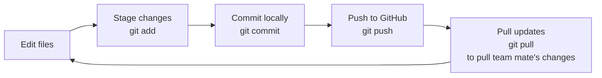

# git-learning

Project to learn about and practise git commands.

## Family tree viewer

Install Python 3 if it is not already available.

Run `python server.py` and open `http://127.0.0.1:8000` to explore the Stanton
family tree. Select a person to see their details, search for a family member,
or use the **Add member** modal to add a son or daughter, choose their parent
from the searchable list, and optionally record a note. People and relationships
are stored in the local
`kinfolk.sqlite3` SQLite database. A new, empty database is seeded with the
sample family on first startup; an intentionally empty family is left empty.
Stop the server with **Ctrl+C**. It listens only on your computer.
Run the backend tests with `python -m unittest`.

## Helpful VSCode shortcuts

- `CTRL+J`: Open/close terminal
- `CTRL+B`: Open/close file explorer

## Setup new repository

**Prerequisites**

- Git Bash installed.
- SSH key generated and added to GitHub settings so you can clone the repository.

```bash
ssh-keygen -t ed25519 -C "dwstanton@yahoo.com"
```

No password needed.

**Setup instructions**

First create a repository in GitHub.

1. Login into GitHub account.
2. Create new repository
3. Open new terminal. Don't click on the + plus. That just opens a powershell. Click on the ⌄ down chevron. Then choose Git Bash
4. Clone repository:

```bash
git clone git@github.com:SturdyDave/git-learning.git
```

## Git basics

```bash
# displays latest changes
git status
```

```bash
# commit all (-a) your changes to the local git history with message (-m)
git commit -a -m "made this change" 
```

```bash
# to stage all untracked files (. is current directory).
# you won't be able to commit new files without first staging them.
git add .
```

```bash
# push your changes up to the remote repository
git push
```

## Basic version control workflow


