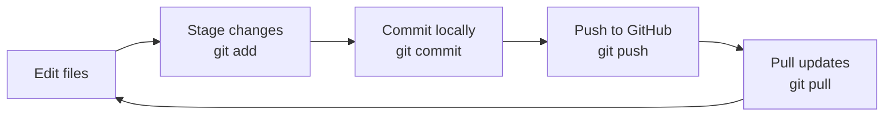

# git-learning

Project to learn about and practise git commands.

## Helpful VSCode shortcuts

- `CTRL+J`: Open/close terminal
- `CTRL+B`: Open/close file explorer

## Setup new repository

**Prerequisites**

- Git Bash installed.
- SSH key generated and added to GitHub settings so you can clone the repository.

```bash
ssh-keygen -t ed25519 -C "dwstanton@yahoo.com"
```

No password needed.

**Setup instructions**

First create a repository in GitHub.

1. Login into GitHub account.
2. Create new repository
3. Open new terminal. Don't click on the + plus. That just opens a powershell. Click on the ⌄ down chevron. Then choose Git Bash
4. Clone repository:

```bash
git clone git@github.com:SturdyDave/git-learning.git
```

## Git basics

```bash
# create new branch (-b) from current branch and then check out new branch
git checkout -b name-of-branch
```

```bash
# displays latest changes
git status
```

```bash
# commit all (-a) your changes to the local git history with message (-m)
git commit -a -m "made this change" 
```

```bash
# push your changes up to the remote repository
git push
```

## Basic version control workflow


